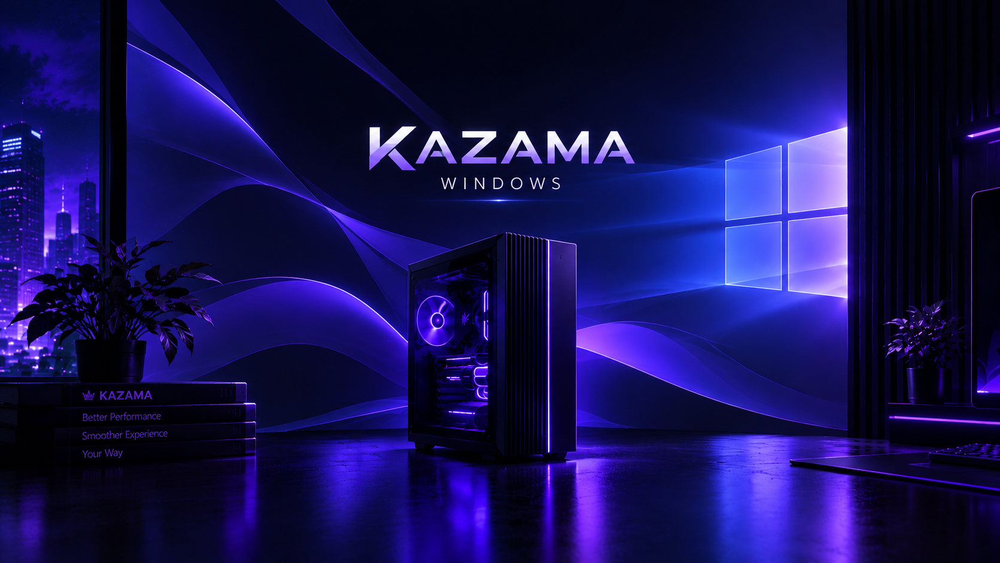
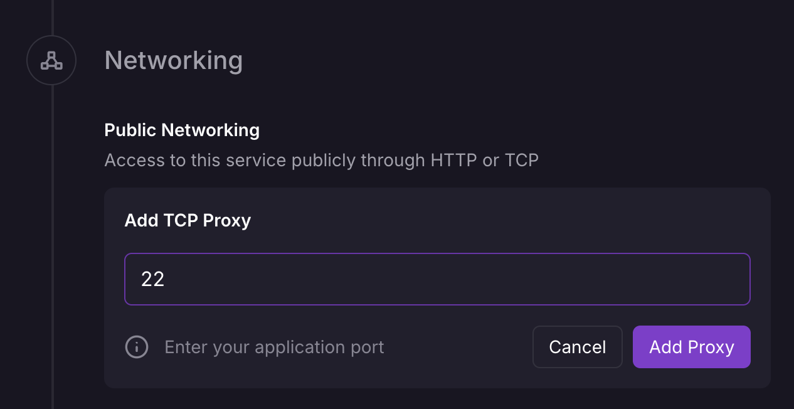

<p align="center">
  
</p>

<h1 align="center">Kazama Windows — RDP 🪟</h1>

<p align="center">
  Desktop Windows Server yang diakses dengan <b>Windows App</b> lewat <b>RDP</b> — di <b>Railway</b> atau di runner Windows <b>GitHub Actions</b>.<br/>
  <b>Ini RDP, bukan VPS.</b>
</p>

<p align="center">
  🇬🇧 <a href="README.md">English</a> &nbsp;·&nbsp; 🇮🇩 Bahasa Indonesia
</p>

<p align="center">
  
  
  
  
</p>

---

## Pilih mode

| | **A · Railway** | **B · GitHub Actions** |
|---|---|---|
| Cara jalan | Windows di dalam QEMU pada container Linux | Runner Windows asli (`windows-latest` / `windows-2025` / `windows-2022`) |
| Kecepatan | **Lambat** (Railway tanpa KVM → emulasi software) | Cepat (VM asli) |
| Durasi | Sampai Anda hentikan (data di Volume) | Maks **6 jam** per run, semua terhapus setelahnya |
| Akses | **TCP Proxy** publik `:3389` **atau** **Tailscale** privat | **Tailscale** (auth key di Secrets/Variables) |
| Rahasia disimpan di | **Variables** Railway | **Secrets and variables → Actions** GitHub |

Kedua mode sudah menyertakan **Storage Booster** dan **wallpaper** Kazama.

## 🧭 Di mana bisa dijalankan?

| Host | Windows berjalan… | Kecepatan | GPU | Cara |
|---|---|---|---|---|
| **Railway** | di dalam QEMU, **emulasi software** | lambat | ❌ | [Mode A](#️-mode-a--railway) — platformnya tidak punya KVM |
| **Host Linux / VPS dengan KVM + Docker** | di dalam QEMU **dengan KVM** | hampir native | hanya dengan setup passthrough sendiri | `docker compose up` — lihat [Jalankan lokal](#️-jalankan-lokal). Banyak VPS murah tanpa nested KVM: cek dengan `kvm-ok` |
| **Mesin Windows milik Anda** (Server, 10/11 Pro, VM Windows di cloud) | **native — tanpa virtual machine sama sekali** | penuh | ✅ GPU asli host | [Jalankan di mesin Windows sendiri](#-jalankan-di-mesin-windows-sendiri-tanpa-vm) |
| **macOS** | tidak bisa menjadi host (Docker Desktop tanpa KVM) | — | — | pakai Mac sebagai **klien RDP** (Windows App) |
| **GitHub Actions** | VM runner asli | cepat | ❌ | [Mode B](#️-mode-b--github-actions-tailscale) — melanggar syarat GitHub, bisa membuat akun disuspend |
| **Panel Pterodactyl** | di dalam QEMU (butuh node Wings dedicated yang dilonggarkan) | lambat tanpa KVM | ❌ | [pterodactyl/README.id.md](pterodactyl/README.id.md) — egg disertakan |

**Kalau ingin menghindari risiko GitHub tapi tetap cepat, pakai dua opsi sebelum terakhir:** server Linux dengan KVM, atau mesin Windows milik Anda.

## ⚠️ Batasan yang jujur

- **Railway lambat.** Railway tidak menyediakan `/dev/kvm`, jadi instalasi pertama bisa **berjam-jam** dan desktop terasa berat. Juga butuh **Volume di `/storage`** (kira-kira 20–30 GB) dan **RAM ≥ 4 GB** — cek batas plan Anda.
- **GitHub Actions tidak dimaksudkan untuk ini.** Syarat GitHub membatasi Actions untuk build/test/deploy proyek Anda; memakainya sebagai remote desktop bisa membuat repo atau akun dibatasi. Risiko ditanggung sendiri, sebaiknya pakai repo privat yang siap dikorbankan.
- **Bukan VPS** di kedua mode: tidak ada server persisten dan tidak ada kernel kustom.
- Lisensi dan aktivasi Windows adalah tanggung jawab Anda.

---

## 🅰️ Mode A — Railway

1. **Fork** repository ini lalu hubungkan ke project Railway baru.
2. **Variables:** isi `RDP_PASSWORD` (wajib). Opsional: `WINDOWS_VERSION`, `TAILSCALE_AUTHKEY`.
3. **Settings → Volumes:** tambahkan Volume di **`/storage`**.
4. **Pilih satu cara terhubung:**
   - **Tailscale (disarankan, privat):** isi `TAILSCALE_AUTHKEY`. Tidak ada port publik yang dibuka.
   - **TCP Proxy publik:** **Settings → Networking → TCP Proxy**, port **`3389`**.

   

   (Pakai `3389`, bukan `22` seperti pada screenshot.)
5. Isi `RAILWAY_DEPLOYMENT_DRAINING_SECONDS=60` agar Windows mati dengan bersih saat redeploy.
6. **Deploy** dan pantau **Deploy Logs** sampai Windows selesai terinstal dan menyala.

### Variabel Railway

| Variabel | Wajib | Default | Keterangan |
|----------|:-----:|---------|------------|
| `RDP_PASSWORD` | ✅ | — | Password user Windows. Min 8 karakter, 3 dari huruf kecil/BESAR/angka/simbol, **tanpa spasi atau `< > & " '`**, tidak boleh memuat username. |
| `WINDOWS_VERSION` | — | `windows-latest` | `windows-latest` (Server 2025), `windows-2025`, `windows-2022`. |
| `RDP_USERNAME` | — | `kazama` | Akun administrator yang dibuat saat instalasi. |
| `TAILSCALE_AUTHKEY` | — | — | Mengaktifkan akses privat lewat Tailscale. Pakai key **ephemeral + reusable**. |
| `TAILSCALE_HOSTNAME` | — | `kazama-windows` | Nama mesin di tailnet Anda. |
| `BOOSTER_MODE` | — | `safe` | `off`, `safe`, `deep`, `max` — lihat [Storage Booster](#-storage-booster). |
| `KAZAMA_TUNE` | — | `light` | Tuning performa di dalam Windows untuk emulasi: `off`, `light`, `max` (max juga mematikan Defender real-time dan Windows Update). Lihat `windows/kazama-tune.ps1`. |
| `BOOSTER_KEEP` | — | `chrome` | Id katalog yang **tidak** boleh dihapus `max`, mis. `chrome,visualstudio`. |
| `BOOSTER_SCHEDULE` | — | `weekly` | `off`, `daily`, `weekly` (03:00, di dalam Windows). |
| `KAZAMA_WALLPAPER` | — | `true` | Terapkan wallpaper Kazama saat logon pertama tiap user. |
| `RAM_SIZE` / `CPU_CORES` / `DISK_SIZE` | — | `4G` / `2` / `40G` | Resource VM (harus muat di plan / Volume). |
| `APP_LANG` | — | `en` | Bahasa log: `en` atau `id`. |

> ℹ️ `RDP_PASSWORD`, `RDP_USERNAME`, `WINDOWS_VERSION`, dan pengaturan booster/wallpaper hanya berlaku saat **instalasi pertama**. Ganti password nanti di dalam Windows; untuk mengganti versi Windows, hapus isi Volume.

---

## 🅱️ Mode B — GitHub Actions (Tailscale)

1. Buat repository **privat** dari repo ini (atau fork).
2. Buat **auth key** Tailscale di <https://login.tailscale.com/admin/settings/keys> — centang **Reusable** dan **Ephemeral**.
3. Di repo: **Settings → Secrets and variables → Actions**
   - **Secrets:** `RDP_PASSWORD`, `TAILSCALE_AUTHKEY`
   - (Variables dengan nama yang sama diterima sebagai cadangan, tetapi **tidak disamarkan** — utamakan Secrets.)
4. **Actions → "Kazama Windows RDP (Tailscale)" → Run workflow**, pilih **windows-latest**, **windows-2025**, atau **windows-2022**, plus level booster.
5. Saat run mencapai *Keep session alive*, buka **job summary** untuk alamatnya, lalu hubungkan.

Input: versi Windows · `boost` (off/safe/deep/**max**, default `max`) · `keep` (aplikasi yang tidak boleh dihapus `max`) · `duration` (maks 345 menit) · `idle_timeout` (berhenti jika tak ada yang terhubung) · `username` · nama Tailscale · `packages` Chocolatey tambahan · `save_files` (unggah Desktop + Documents saat selesai) · `language`.

---

## 🔌 Hubungkan dengan Windows App

1. Jika memakai Tailscale, pastikan aktif di perangkat Anda dan masuk ke tailnet yang sama.
2. **Windows App → + → PC.**
3. **PC name:** IP / nama mesin Tailscale, **atau** (TCP Proxy Railway) `<domain-proxy>:<port-proxy>`.
4. **User account → Add user account:** username = `RDP_USERNAME` (default `kazama`), password = `RDP_PASSWORD`.
5. Simpan, hubungkan, setujui peringatan sertifikat.

---

## 🧹 Storage Booster

Membebaskan ruang disk `C:` dengan menghapus file yang bisa dibuat ulang Windows atau tidak diperlukan, lalu menampilkan
**ruang kosong sebelum → sesudah** (mis. `30 GB → 50 GB`). Besar hasilnya tergantung kondisi mesin.

| Mode | Yang dihapus |
|------|--------------|
| **safe** | File sementara, crash dump, cache unduhan Windows Update, cache Delivery Optimization, laporan error, log CBS, cache Edge/Chrome, cache npm/pip, Recycle Bin, + TRIM disk |
| **deep** | semua di *safe* **ditambah** pembersihan component store Windows (`DISM`; `/ResetBase` yang lebih lambat opsional dengan `KZ_DISM_RESETBASE=true`), file hibernasi, shadow copy, event log, `Windows.old`, cache paket installer |
| **max** | semua di *deep* **ditambah menghapus aplikasi dan SDK di [`windows/kazama-catalog.psd1`](windows/kazama-catalog.psd1)**: Edge, Firefox, Unity, R (+ Rtools), Haskell (ghcup/cabal), Android SDK, Julia, Miniconda, Rust, MSYS2, MySQL, PostgreSQL, MongoDB, Cosmos DB Emulator, dan **Visual Studio** |

**`safe` hanya membersihkan cache, jadi hasilnya kecil (sekitar 1 GB di runner).** Hasil besar di runner GitHub datang dari `max`, yang menghapus aplikasi dan SDK bawaan.

Detail `max`:
- **Chrome selalu dipertahankan.** Jika Edge akan dihapus dan Chrome belum ada, Chrome dipasang dulu; jika gagal, Edge tetap ada.
- Tiap entri katalog hanya dijalankan bila benar-benar terpasang, dan folder berversi (`R-4.3.x`, `Visual Studio\2022` …) dicocokkan dengan wildcard, sehingga katalog yang sama bekerja di `windows-latest`, `windows-2025`, dan `windows-2022`. Profil yang terdeteksi (`win2022` / `win2025`) dicetak di log dan job summary.
- **Lindungi apa pun dengan `keep`** (input Actions) atau `BOOSTER_KEEP` (Railway), mis. `chrome,visualstudio`. Id entri ada di file katalog; tambahkan entri Anda sendiri di sana.
- Menghapus folder besar (Visual Studio puluhan GB) butuh beberapa menit. Log menampilkan berapa yang dibebaskan tiap entri.

- **Shortcut desktop** *Kazama Storage Booster* — jalankan kapan saja (meminta hak admin).
- **Jalan otomatis** — mode Railway: scheduled task (`BOOSTER_SCHEDULE`); mode Actions: dijalankan sebelum Anda terhubung.
- Pengaturan dan log: `C:\Kazama\kazama.conf`, `C:\Kazama\booster.log`.
- `deep` dan `max` untuk desktop sekali pakai: update Windows tidak bisa dicopot lagi dan aplikasi hilang permanen.

---

## 🗂️ Struktur proyek

```text
.
├── Dockerfile                       # Mode A: dockurr/windows + wrapper Kazama + Tailscale
├── compose.yml                      # jalankan lokal (host Linux dengan KVM)
├── railway.json / railway-template.json
├── rootfs/usr/local/
│   ├── bin/kazama-entrypoint        # validasi, pemetaan versi, Tailscale, konfigurasi OEM
│   └── lib/kazama/common.sh         # i18n (en/id) + logging
├── windows/                         # berjalan DI DALAM Windows (kedua mode)
│   ├── install.bat                  # Railway: dijalankan dockur di akhir instalasi
│   ├── kazama-setup.ps1             # task wallpaper, shortcut + jadwal booster, tuning
│   ├── kazama-tune.ps1              # tuning performa untuk Windows emulasi / kecil
│   ├── install-windows.ps1          # pasang di mesin Windows sendiri (tanpa VM)
│   ├── kazama-booster.ps1           # Storage Booster (safe / deep / max)
│   ├── kazama-catalog.psd1          # aplikasi & SDK yang dihapus `max` (bisa diedit)
│   └── kazama-wallpaper.ps1         # wallpaper per user
├── scripts/                         # Mode B: skrip runner GitHub Actions
├── pterodactyl/                     # Egg Pterodactyl + panduan lengkap (EN / ID)
├── assets/                          # wallpaper + screenshot
└── .github/workflows/
    ├── rdp.yml                      # workflow Mode B
    └── ci.yml                       # ShellCheck + sintaks PowerShell + Docker build
```

## 🪟 Jalankan di mesin Windows sendiri (tanpa VM)

Di Windows Server / Windows 10-11 **Pro** asli (PC rumah, server kantor, VM Windows di cloud) **tidak ada virtual machine dan tidak ada emulasi** — hanya Windows, kecepatan penuh, dengan GPU asli host. Installer mengubahnya menjadi desktop RDP siap pakai: RDP + user login + Tailscale (opsional) + Storage Booster + wallpaper.

1. Unduh repository ini sebagai ZIP (atau `git clone`) ke mesin tersebut.
2. Buka **PowerShell sebagai Administrator** di folder repository lalu jalankan:

   ```powershell
   powershell -ExecutionPolicy Bypass -File windows\install-windows.ps1 -Username kazama -TailscaleAuthKey tskey-auth-xxxx -Booster safe
   ```

   Password ditanyakan secara interaktif (tidak pernah muncul di command line). Opsi: `-Booster off|safe|deep|max`, `-Tune off|light|max`, `-Language en|id`, `-Keep chrome,...`, `-SkipWallpaper`; hilangkan `-TailscaleAuthKey` untuk melewati Tailscale.
3. Hubungkan dengan **Windows App** ke PC name yang dicetak di akhir.

Windows Home tidak bisa menjadi host Remote Desktop. Lewat internet utamakan Tailscale daripada membuka port 3389.

## ❓ FAQ

**Kenapa ada baris merah di log Railway, tapi container tetap jalan?**
Itu peringatan dari image upstream, bukan crash. Yang umum: *"KVM acceleration is not available"* (Railway tidak punya `/dev/kvm`) dan *"failed to create bridge … NET_ADMIN"* (container Railway tanpa hak istimewa). Windows lalu lanjut dengan emulasi software dan jaringan user-mode — port RDP 3389 tetap diteruskan. Baru perlu khawatir jika container benar-benar restart atau log berhenti; saat itu baca baris merah terakhir.

**Bisa menambah GPU di Railway?**
Tidak. Railway menjalankan container tanpa hak istimewa dan dukungan mereka menyatakan tidak menyediakan `/dev/kvm`, container privileged, atau nested virtualization; saya juga tidak menemukan tawaran GPU untuk container. GPU butuh host yang mengeksposnya — mesin Windows Anda sendiri (native) atau host Linux dengan passthrough GPU sendiri.

**Bisa menghilangkan virtual machine-nya?**
Tidak di Railway: Windows butuh kernelnya sendiri, dan container Linux tidak bisa menyediakannya. Satu-satunya cara *tanpa VM* adalah menjalankan Windows **native** (lihat di atas). Railway pernah menyebut runtime berbasis VM di masa depan bisa mengizinkan virtualisasi; belum ada tanggal.

**Bagaimana membuatnya tidak terlalu lambat di Railway?**
Isi `KAZAMA_TUNE=light` (default) atau `max` — mematikan pekerjaan latar belakang yang memakan CPU emulasi (Server Manager, indexing, telemetri, maintenance, dan di `max` juga Defender real-time dan Windows Update). Pakai `BOOSTER_MODE=max` untuk ruang. Tetap lambat: perkirakan menit, bukan detik, untuk aksi berat.

## 🔒 Keamanan

- RDP publik terus dipindai orang — pakai **`RDP_PASSWORD` panjang dan unik** dan utamakan **Tailscale** (NLA tetap aktif di kedua cara).
- Web viewer (port 8006) tidak punya password. **Jangan buat domain publik Railway untuknya.** Lewat Tailscale ia bisa diakses privat di `<ip-tailscale>:8006`.
- Simpan key dan password di Variables Railway / **Secrets** GitHub, jangan di repo.

## 🩺 Pemecahan masalah

| Masalah | Solusi |
|---------|--------|
| Container langsung berhenti | Log menjelaskan penyebabnya — `RDP_PASSWORD` kosong/lemah, atau `WINDOWS_VERSION` tidak didukung. |
| Windows diinstal ulang tiap deploy | Belum ada Volume di `/storage`. |
| Tailscale tidak terhubung (Railway) | Lihat deploy logs; periksa auth key. Tailscale juga harus aktif di perangkat Anda. |
| Wallpaper tidak tampil | Diterapkan saat logon pertama tiap user; klien Windows App harus mengaktifkan *Desktop background*. |
| `RDP_PASSWORD is missing` (Actions) | Tambahkan di **Secrets and variables → Actions**. |

## 🛠️ Jalankan lokal

Di host Linux dengan KVM ini **cepat**:

```bash
RDP_PASSWORD='Str0ng#Pass9' docker compose up --build
# web viewer: http://localhost:8006   ·   RDP: localhost:3389
```

## 📄 Lisensi

MIT — lihat [LICENSE](LICENSE). Mode A dibangun di atas [dockur/windows](https://github.com/dockur/windows) (MIT).

---

<p align="center">
  © Kazama Tech · Dikembangkan oleh <a href="https://github.com/kazamaofficial-git"><b>@kazamaofficial-git</b></a> ·
  <a href="https://github.com/kazamaofficial-git/kazama-windows">Repository</a>
</p>
