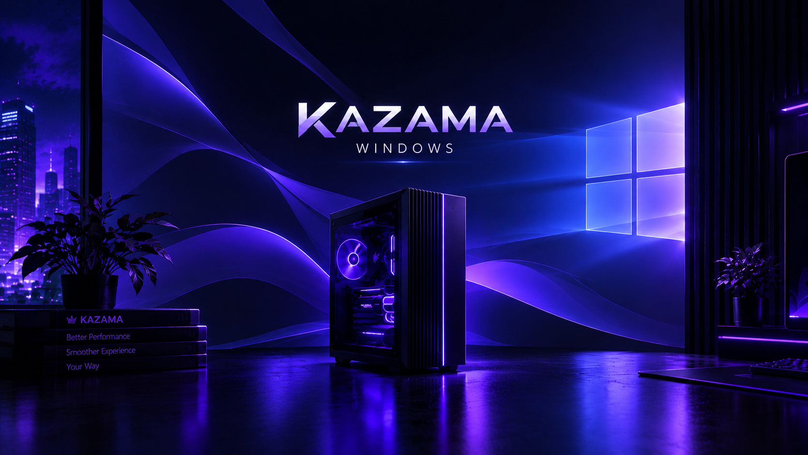
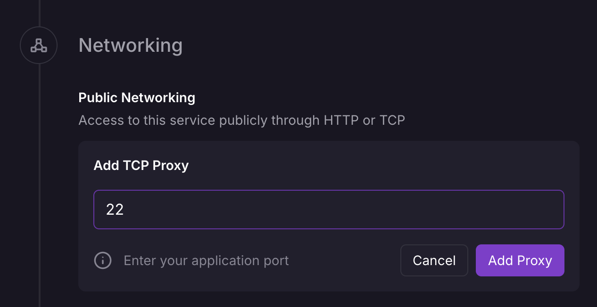

<p align="center">
  
</p>

<h1 align="center">Kazama Windows — RDP 🪟</h1>

<p align="center">
  A Windows Server desktop you reach with <b>Windows App</b> over <b>RDP</b> — on <b>Railway</b> or on a <b>GitHub Actions</b> Windows runner.<br/>
  <b>This is an RDP desktop, not a VPS.</b>
</p>

<p align="center">
  🇬🇧 English &nbsp;·&nbsp; 🇮🇩 <a href="README.id.md">Bahasa Indonesia</a>
</p>

<p align="center">
  
  
  
  
</p>

---

## Choose your mode

| | **A · Railway** | **B · GitHub Actions** |
|---|---|---|
| How it runs | Windows inside QEMU in a Linux container | Real Windows runner (`windows-latest` / `windows-2025` / `windows-2022`) |
| Speed | **Slow** (no KVM on Railway → software emulation) | Fast (real VM) |
| Lasts | Until you stop it (data on a Volume) | Max **6 h** per run, everything erased after |
| Access | Public **TCP Proxy** `:3389` **or** private **Tailscale** | **Tailscale** (auth key in Secrets/Variables) |
| Secrets live in | Railway **Variables** | GitHub **Secrets and variables → Actions** |

Both modes include the **Storage Booster** and the Kazama **wallpaper**.

## 🧭 Where can I run this?

| Host | Windows runs… | Speed | GPU | How |
|---|---|---|---|---|
| **Railway** | inside QEMU, **software emulation** | slow | ❌ | [Mode A](#️-mode-a--railway) — the platform has no KVM |
| **Linux host / VPS with KVM + Docker** | inside QEMU **with KVM** | near-native | only with your own passthrough setup | `docker compose up` — see [Run locally](#️-run-locally). Many cheap VPSes have no nested KVM: check with `kvm-ok` |
| **A Windows machine you control** (Server, 10/11 Pro, cloud Windows VM) | **natively — no virtual machine at all** | full | ✅ the host's real GPU | [Run on your own Windows machine](#-run-on-your-own-windows-machine-no-vm) |
| **macOS** | cannot host it (no KVM in Docker Desktop) | — | — | use the Mac as the **RDP client** (Windows App) |
| **GitHub Actions** | real runner VM | fast | ❌ | [Mode B](#️-mode-b--github-actions-tailscale) — against GitHub's terms, can get you suspended |
| **Pterodactyl panel** | inside QEMU (needs a relaxed, dedicated Wings node) | slow without KVM | ❌ | [pterodactyl/README.md](pterodactyl/README.md) — egg included |

**If you want to avoid the GitHub risk and still be fast, use the last-but-one options:** a Linux box with KVM, or a Windows machine you control.

## ⚠️ Honest limits

- **Railway is slow.** Railway does not expose `/dev/kvm`, so the first install can take **hours** and the desktop feels sluggish. It also needs a **Volume at `/storage`** (roughly 20–30 GB) and **≥ 4 GB RAM** — check your plan's limits.
- **GitHub Actions is not meant for this.** GitHub's terms limit Actions to building/testing/deploying your project; using it as a remote desktop can get the repository or account restricted. Use at your own risk, preferably on a private repo you can afford to lose.
- **Not a VPS** in either mode: no persistent server, no custom kernel.
- Windows licensing and activation are your responsibility.

---

## 🅰️ Mode A — Railway

1. **Fork** this repository and connect it to a new Railway project.
2. **Variables:** set `RDP_PASSWORD` (required). Optional: `WINDOWS_VERSION`, `TAILSCALE_AUTHKEY`.
3. **Settings → Volumes:** add a Volume mounted at **`/storage`**.
4. **Pick one way to connect:**
   - **Tailscale (recommended, private):** set `TAILSCALE_AUTHKEY`. No public port is opened.
   - **Public TCP Proxy:** **Settings → Networking → TCP Proxy**, port **`3389`**.

   

   (Use `3389`, not the `22` shown in the screenshot.)
5. Set `RAILWAY_DEPLOYMENT_DRAINING_SECONDS=60` so Windows can shut down cleanly on redeploy.
6. **Deploy** and follow the **Deploy Logs** until Windows has installed and booted.

### Railway variables

| Variable | Required | Default | Description |
|----------|:--------:|---------|-------------|
| `RDP_PASSWORD` | ✅ | — | Windows user password. 8+ chars, 3 of lower/UPPER/digits/symbols, **no spaces or `< > & " '`**, must not contain the username. |
| `WINDOWS_VERSION` | — | `windows-latest` | `windows-latest` (Server 2025), `windows-2025`, `windows-2022`. |
| `RDP_USERNAME` | — | `kazama` | Administrator account created at install. |
| `TAILSCALE_AUTHKEY` | — | — | Enables private access over Tailscale. Use an **ephemeral, reusable** key. |
| `TAILSCALE_HOSTNAME` | — | `kazama-windows` | Machine name in your tailnet. |
| `BOOSTER_MODE` | — | `safe` | `off`, `safe`, `deep`, `max` — see [Storage Booster](#-storage-booster). |
| `KAZAMA_TUNE` | — | `light` | Performance tuning inside Windows for emulation: `off`, `light`, `max` (max also turns off Defender real-time and Windows Update). See `windows/kazama-tune.ps1`. |
| `BOOSTER_KEEP` | — | `chrome` | Catalog ids that `max` must **not** remove, e.g. `chrome,visualstudio`. |
| `BOOSTER_SCHEDULE` | — | `weekly` | `off`, `daily`, `weekly` (03:00, inside Windows). |
| `KAZAMA_WALLPAPER` | — | `true` | Apply the Kazama wallpaper on each user's first logon. |
| `RAM_SIZE` / `CPU_CORES` / `DISK_SIZE` | — | `4G` / `2` / `40G` | VM resources (must fit your plan / Volume). |
| `APP_LANG` | — | `en` | Log language: `en` or `id`. |

> ℹ️ `RDP_PASSWORD`, `RDP_USERNAME`, `WINDOWS_VERSION` and the booster/wallpaper settings are applied **only at the first install**. Change the password later inside Windows; to change the Windows version, wipe the Volume.

---

## 🅱️ Mode B — GitHub Actions (Tailscale)

1. Create a **private** repository from this one (or fork it).
2. Create a Tailscale **auth key** at <https://login.tailscale.com/admin/settings/keys> — tick **Reusable** and **Ephemeral**.
3. In the repo: **Settings → Secrets and variables → Actions**
   - **Secrets:** `RDP_PASSWORD`, `TAILSCALE_AUTHKEY`
   - (Variables with the same names are accepted as a fallback, but they are **not masked** — prefer Secrets.)
4. **Actions → "Kazama Windows RDP (Tailscale)" → Run workflow** and choose **windows-latest**, **windows-2025** or **windows-2022**, plus the booster level.
5. When the run reaches *Keep session alive*, open the **job summary** for the address, then connect.

Inputs: Windows version · `boost` (off/safe/deep/**max**, default `max`) · `keep` (apps `max` must not remove) · `duration` (max 345 min) · `idle_timeout` (stops when nobody is connected) · `username` · Tailscale name · extra Chocolatey `packages` · `save_files` (uploads Desktop + Documents when it ends) · `language`.

---

## 🔌 Connect with Windows App

1. If you use Tailscale, make sure it is running on your device and signed in to the same tailnet.
2. **Windows App → + → PC.**
3. **PC name:** the Tailscale IP / machine name, **or** (Railway TCP Proxy) `<proxy-domain>:<proxy-port>`.
4. **User account → Add user account:** username = `RDP_USERNAME` (default `kazama`), password = `RDP_PASSWORD`.
5. Save, connect, accept the certificate prompt.

---

## 🧹 Storage Booster

Frees disk space on `C:` by deleting files Windows can rebuild or never needs, then shows
**free space before → after** (e.g. `30 GB → 50 GB`). How much you gain depends on the machine.

| Mode | What it removes |
|------|-----------------|
| **safe** | Temp files, crash dumps, Windows Update download cache, Delivery Optimization cache, error reports, CBS logs, Edge/Chrome caches, npm/pip caches, Recycle Bin, + disk TRIM |
| **deep** | everything in *safe* **plus** hibernation file, shadow copies, `Windows.old`, installer package cache (slow, small-gain extras — DISM component clean-up and event logs — are opt-in with `KZ_SLOW_CLEANUP=true`) |
| **max** | everything in *deep* **plus uninstalls/deletes the apps and SDKs in [`windows/kazama-catalog.psd1`](windows/kazama-catalog.psd1)**: Edge, Firefox, Unity, R (+ Rtools), Haskell (ghcup/cabal), Android SDK, Julia, Miniconda, Rust, MSYS2, MySQL, PostgreSQL, MongoDB, Cosmos DB Emulator and **Visual Studio** |

**`safe` only frees caches, so expect a small gain (about 1 GB on a runner).** The big wins on GitHub runners come from `max`, which removes the pre-installed apps and SDKs.

`max` details:
- **Chrome is always kept.** If Edge is to be removed and Chrome is missing, Chrome is installed first; if that fails, Edge stays.
- Each catalog entry only runs when it is actually installed, and version folders (`R-4.3.x`, `Visual Studio\2022` …) are matched with wildcards, so the same catalog works on `windows-latest`, `windows-2025` and `windows-2022`. The detected profile (`win2022` / `win2025`) is printed in the log and the job summary.
- **Protect anything with `keep`** (Actions input) or `BOOSTER_KEEP` (Railway), e.g. `chrome,visualstudio`. Entry ids are listed in the catalog file; add your own entries there.
- Deleting big trees (Visual Studio is tens of GB) takes a few minutes. The log shows how much each entry freed.

- **Desktop shortcut** *Kazama Storage Booster* — run it any time (it asks for admin rights).
- **Automatic run** — Railway mode: scheduled task (`BOOSTER_SCHEDULE`); Actions mode: runs before you connect.
- Settings and log: `C:\Kazama\kazama.conf`, `C:\Kazama\booster.log`.
- `deep` and `max` are for disposable desktops: Windows updates become non-removable and apps are gone for good.

---

## 🗂️ Project structure

```text
.
├── Dockerfile                       # Mode A: dockurr/windows + Kazama wrapper + Tailscale
├── compose.yml                      # run locally (Linux host with KVM)
├── railway.json / railway-template.json
├── rootfs/usr/local/
│   ├── bin/kazama-entrypoint        # validation, version mapping, Tailscale, OEM config
│   └── lib/kazama/common.sh         # i18n (en/id) + logging
├── windows/                         # runs INSIDE Windows (both modes)
│   ├── install.bat                  # Railway: executed by dockur at the end of install
│   ├── kazama-setup.ps1             # wallpaper task, booster shortcut + schedule, tuning
│   ├── kazama-tune.ps1              # performance tuning for emulated / small Windows
│   ├── install-windows.ps1          # install on your own Windows machine (no VM)
│   ├── kazama-booster.ps1           # Storage Booster (safe / deep / max)
│   ├── kazama-catalog.psd1          # apps & SDKs that `max` removes (editable)
│   └── kazama-wallpaper.ps1         # per-user wallpaper
├── scripts/                         # Mode B: GitHub Actions runner scripts
├── pterodactyl/                     # Pterodactyl egg + full guide (EN / ID)
├── assets/                          # wallpaper + screenshot
└── .github/workflows/
    ├── rdp.yml                      # Mode B workflow
    └── ci.yml                       # ShellCheck + PowerShell syntax + Docker build
```

## 🪟 Run on your own Windows machine (no VM)

On a real Windows Server / Windows 10-11 **Pro** (home PC, office server, cloud Windows VM) there is **no virtual machine and no emulation** — it is just Windows, at full speed, with the host's real GPU. The installer turns it into a ready RDP desktop: RDP + login user + optional Tailscale + Storage Booster + wallpaper.

1. Download this repository as a ZIP (or `git clone`) onto the machine.
2. Open **PowerShell as Administrator** in the repository folder and run:

   ```powershell
   powershell -ExecutionPolicy Bypass -File windows\install-windows.ps1 -Username kazama -TailscaleAuthKey tskey-auth-xxxx -Booster safe
   ```

   You are asked for the password interactively (it never appears on the command line). Options: `-Booster off|safe|deep|max`, `-Tune off|light|max`, `-Language en|id`, `-Keep chrome,...`, `-SkipWallpaper`; omit `-TailscaleAuthKey` to skip Tailscale.
3. Connect with **Windows App** to the PC name printed at the end.

Windows Home cannot host Remote Desktop. Over the internet prefer Tailscale instead of exposing port 3389.

## ❓ FAQ

**Why are there red lines in the Railway logs, but the container keeps running?**
Those are warnings from the upstream image, not crashes. Typical ones: *"KVM acceleration is not available"* (Railway has no `/dev/kvm`) and *"failed to create bridge … NET_ADMIN"* (Railway containers are unprivileged). Windows then continues with software emulation and user-mode networking — RDP port 3389 is still forwarded. Only worry if the container actually restarts or the logs stop; in that case read the last red lines.

**Can I add a GPU on Railway?**
No. Railway runs unprivileged containers and its support states it provides no `/dev/kvm`, privileged containers or nested virtualization; I found no GPU offering for containers either. A GPU needs a host that exposes one — your own Windows machine (native) or a Linux host with your own GPU passthrough.

**Can the virtual machine be removed?**
Not on Railway: Windows needs its own kernel, and a Linux container cannot provide it. The only way to have *no VM* is to run Windows **natively** (see above). Railway has said a future VM-based runtime could allow virtualization; there is no date.

**How do I make it less slow on Railway?**
Set `KAZAMA_TUNE=light` (default) or `max` — it disables background work that eats emulated CPU (Server Manager, indexing, telemetry, maintenance, and with `max` also Defender real-time and Windows Update). Use `BOOSTER_MODE=max` for space. It stays slow: expect minutes, not seconds, for heavy actions.

## 🔒 Security

- Public RDP is probed constantly — use a **long, unique `RDP_PASSWORD`** and prefer **Tailscale** (NLA stays enabled either way).
- The web viewer (port 8006) has no password. **Do not create a public Railway domain for it.** Over Tailscale it is reachable privately at `<tailscale-ip>:8006`.
- Keep keys and passwords in Railway Variables / GitHub **Secrets**, never in the repo.

## 🩺 Troubleshooting

| Problem | Fix |
|---------|-----|
| Container exits immediately | The log says why — missing/weak `RDP_PASSWORD`, or unsupported `WINDOWS_VERSION`. |
| Windows reinstalls every deploy | No Volume at `/storage`. |
| Tailscale does not connect (Railway) | See the deploy logs; check the auth key. Tailscale must run on your device too. |
| Wallpaper not shown | Applied on each user's first logon; the Windows App client must have *Desktop background* enabled. |
| Windows App cannot connect / rejects the credentials (Actions) | Open the job summary → **RDP self-test** (it shows which check failed). Make sure Tailscale runs on your device. If the credentials are rejected, sign in as `COMPUTERNAME\user` (computer name is in the summary). As a last resort run the workflow with `nla` turned off (only safe over Tailscale). |
| `RDP_PASSWORD is missing` (Actions) | Add it under **Secrets and variables → Actions**. |

## 🛠️ Run locally

On a Linux host with KVM this is **fast**:

```bash
RDP_PASSWORD='Str0ng#Pass9' docker compose up --build
# web viewer: http://localhost:8006   ·   RDP: localhost:3389
```

## 📄 License

MIT — see [LICENSE](LICENSE). Mode A builds on [dockur/windows](https://github.com/dockur/windows) (MIT).

---

<p align="center">
  © Kazama Tech · Developed by <a href="https://github.com/kazamaofficial-git"><b>@kazamaofficial-git</b></a> ·
  <a href="https://github.com/kazamaofficial-git/kazama-windows">Repository</a>
</p>
